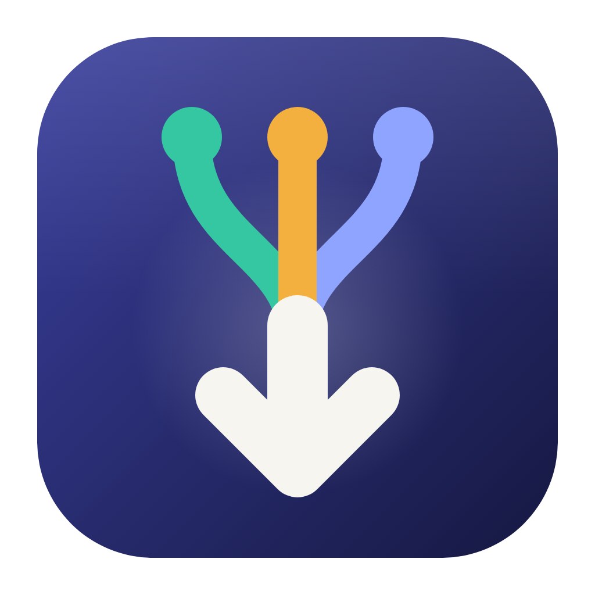
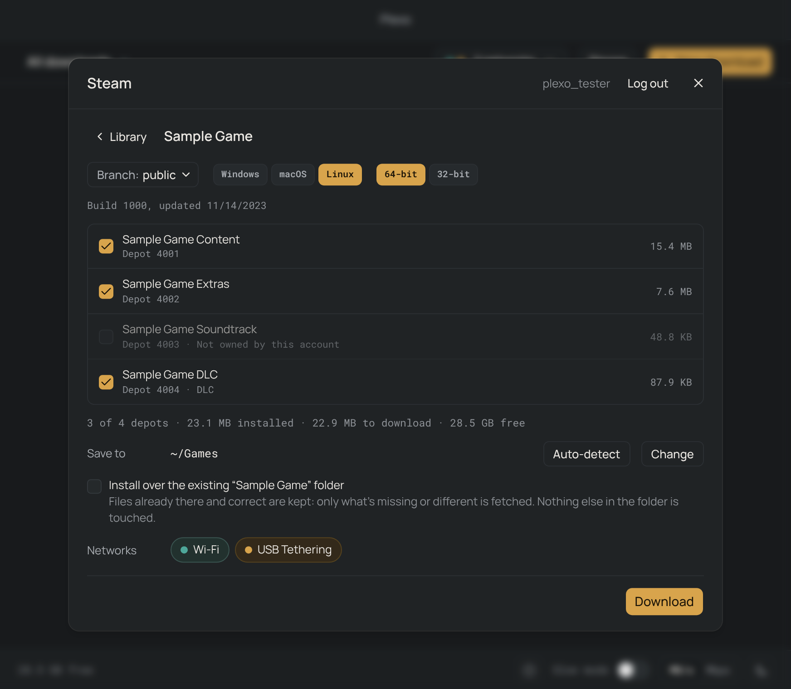
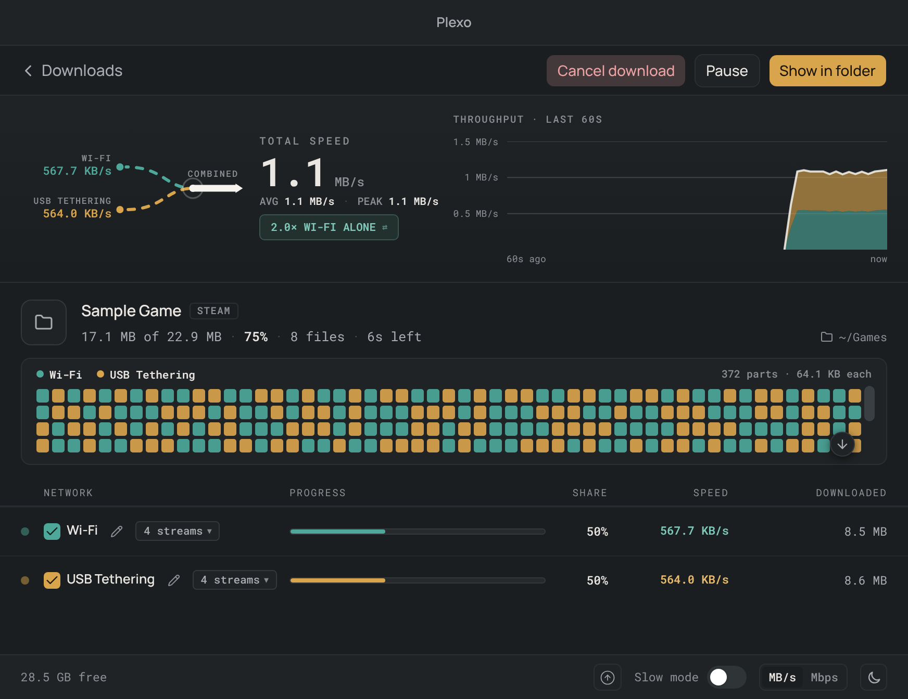

<p align="center">
  
</p>

<h1 align="center">Plexo, with Steam downloads</h1>

<p align="center">
  Download your Steam games, files and torrents faster by combining all your internet connections.<br>
  A fork of <a href="https://github.com/anmolkapil/plexo">Plexo</a> that adds the games your Steam account owns, fetched over Wi-Fi, Ethernet and a tethered phone at once.
</p>

<p align="center">
  <a href="#steam-downloads">Steam downloads</a> ·
  <a href="#install">Install</a> ·
  <a href="#features">Features</a> ·
  <a href="#troubleshooting">Troubleshooting</a> ·
  <a href="#how-it-works">How it works</a> ·
  <a href="#credits">Credits</a>
</p>

<p align="center">
  <a href="https://github.com/anmolkapil/plexo"></a>
  
  
  <a href="LICENSE"></a>
</p>

<p align="center">
  
  
</p>

<p align="center"><sub>Shown with a sample game from the test suite.</sub></p>

## Steam downloads

Click **Steam** next to **New download**, log in, and pick a game from your library. Plexo fetches its depot chunks from Steam's content servers over every network you select, at the same time.

- **Log in** with your account name and password, with a Steam Guard code from email or the Steam Mobile App, or by scanning a QR code
- **Browse and search** the games and apps your account owns, Family Sharing included
- **Choose** the branch, system, architecture, language and depots, with download size, install size and free space shown
- **Auto-detect** your Steam library's `steamapps/common` folder, on any drive
- **Install over an existing folder**: what's already there and correct is kept, and only what's missing or different is fetched
- **Combine networks**: chunks are spread across connections, faster networks fetch more, and speed limits and data allowances apply as for any download
- **Every chunk is checked** against Steam's manifest before it's written. A damaged copy is fetched again from another server.
- **Pause, resume and restart** without losing progress. Cancelling removes only what the download installed.

### Using it

1. Click **Steam** and log in.
2. Pick a game. The depots Steam itself would install are already ticked.
3. Click **Auto-detect** to save it into your Steam library, or **Change** to pick another folder.
4. Click **Download**.
5. In Steam, click **Install** on the game. Steam finds the files Plexo downloaded and checks them instead of downloading them again.

### Your account

- **Only what you own.** Plexo downloads only the apps and depots your account is licensed for. When Steam turns a depot down, Plexo says so and stops.
- **No password is kept.** Your password and Steam Guard codes go to Steam once, and are never stored or logged.
- **Staying logged in** keeps only Steam's login token, encrypted with your system's keychain. Without one (some Linux setups), nothing is stored, and you log in each time Plexo starts.
- **Secrets stay in the background.** The app's window never sees a token, password or depot key.
- **No telemetry.** For Steam downloads, Plexo talks only to Steam and the content servers Steam hands out.

### Status

This is a preview. Steam downloads are tested end to end against a stand-in for Steam, which serves real manifests and chunks, and fails the ways real servers do. Known gaps:

- Steam lists a game only after you click **Install** on it in Steam. Having Plexo register it with Steam is planned.
- Password-protected beta branches aren't supported.

The design and its reasoning are in [docs/steam/DESIGN.md](docs/steam/DESIGN.md). Please report problems with Steam downloads in [this repository's issues](https://github.com/MerikhSS/plexo_steam-/issues).

## Install

There are no prebuilt installers yet: Plexo builds from source in a few minutes. You need [Git](https://git-scm.com/) and [Node.js](https://nodejs.org/) 22.13 or later.

```bash
git clone https://github.com/MerikhSS/plexo_steam-.git
cd plexo_steam-
npm ci
npm run dev
```

`npm run dev` opens the app straight from the source. To make an installer instead, run the command for your system. The result is in `dist/`.

| System  | Command               | Creates                                     |
| ------- | --------------------- | ------------------------------------------- |
| Windows | `npm run build:win`   | An installer for x64 and ARM64              |
| macOS   | `npm run build:mac`   | `.dmg` packages for Apple silicon and Intel |
| Linux   | `npm run build:linux` | AppImage, `.deb`, `.rpm` and `.tar.gz`      |

Each system's build runs on that system. Local builds are unsigned, so your system warns you the first time you open one.

This build uses the same app ID as Plexo: installing it replaces an installed Plexo and keeps its settings and download list.

<details>
<summary><strong><code>npm ci</code> fails on Windows with "node-gyp failed to rebuild"</strong></summary>
<br>

A dependency of the torrent engine has an optional native part, which needs Microsoft's C++ build tools to compile. Plexo doesn't need it. Install without it:

```bat
npm ci --ignore-scripts
npx patch-package
npx install-electron
```

Then run `npm run dev` or `npm run build:win` as above. Or install **Visual Studio Build Tools** with the **Desktop development with C++** workload, and run `npm ci` again.

</details>

## Features

Everything Plexo does, for files and torrents as well as Steam games.

https://github.com/user-attachments/assets/e57728f4-fb63-441f-839c-174eef954b17

### Multi-network downloads

- Combine multiple internet connections for faster downloads
- Enable or disable networks during a download
- Rename networks and customize their colors
- Download file chunks in parallel across connections
- Balance chunks across connections, with faster networks handling more of the download
- Automatically adjust parallel streams to network, server and disk performance
- Race slow chunks on idle connections to avoid a slow finish
- View live speeds, time remaining and per-network progress

### Browser integration

- Capture downloads or send individual links to Plexo
- Download files using your browser’s authenticated session
- Exclude websites and skip small files

### Download management

- Download direct links, magnet links, `.torrent` files and Steam games
- Select torrent files before or during a download
- Pause and resume supported downloads across restarts
- Automatically reconnect downloads after sleep
- Replace expired links without losing progress
- Queue downloads and configure concurrent downloads
- Pause, resume, retry or remove downloads in bulk

### Bandwidth controls

- Set global and per-network speed limits
- Switch to Slow mode for calls and streaming
- Set daily, weekly or monthly data allowances
- Schedule downloads by time and day

## Troubleshooting

If your problem isn't covered here, [open an issue](https://github.com/MerikhSS/plexo_steam-/issues).

<details>
<summary><strong>Steam doesn't list a game Plexo downloaded</strong></summary>
<br>

Click **Install** on the game in Steam, with the same library selected. Steam finds the files already there, checks them, and fetches only what doesn't match.

</details>

<details>
<summary><strong>A Steam download says "Log in to Steam to continue"</strong></summary>
<br>

The login ended: Plexo was restarted without **Stay logged in**, or Steam ended the session. Click **Log in to Steam** on the download, log in, then click **Retry**. Nothing already downloaded is lost.

</details>

<details>
<summary><strong>"Stay logged in" can't be ticked</strong></summary>
<br>

Plexo keeps a login only when your system can encrypt it with its keychain. On Linux, install and unlock a keyring such as GNOME Keyring or KWallet. Without one, you log in each time Plexo starts.

</details>

<details>
<summary><strong>Windows says "Windows protected your PC"</strong></summary>
<br>

The installer isn't code-signed. Click **More info**, then **Run anyway**.

</details>

<details>
<summary><strong>A second network doesn't make downloads faster</strong></summary>
<br>

Plexo adds speed only when each network reaches the internet through its own connection. Wi-Fi from your home router plus a phone tethered over USB works. Wi-Fi and Ethernet plugged into the same router doesn't: both share one connection, so the total stays the same.

VPN, virtual, and isolated adapters show up in Plexo too, so check each network's latency and speed there.

</details>

<details>
<summary><strong>A network doesn't appear in Plexo</strong></summary>
<br>

Plexo can use any connection your operating system shows as a network adapter.

- **iPhone on macOS**: in **System Settings › Network**, open **iPhone USB** and turn off **Disable unless needed**
- **Android on macOS**: install TetherKit, as described below
- **Phone on Windows**: install your phone maker's driver if the phone doesn't appear in Network Settings

</details>

<details>
<summary><strong>Windows uses only one network</strong></summary>
<br>

If Windows turns Wi-Fi off when Ethernet is plugged in, open the Group Policy Editor (`gpedit.msc`), go to _Computer Configuration_ › _Administrative Templates_ › _Network_ › _Windows Connection Manager_, and set **Minimize the number of simultaneous connections to the Internet or a Windows domain** to **Disabled**.

If both stay connected but one sits idle in Plexo, Windows may be sending its traffic out the other network. Plexo's own [#65](https://github.com/anmolkapil/plexo/issues/65) collects these setups.

</details>

<details>
<summary><strong>A network stays idle after reconnecting a phone</strong></summary>
<br>

Pause the download, then resume it.

</details>

<details>
<summary><strong>Downloads to a hard drive are slow</strong></summary>
<br>

Leave **Streams** on **Auto** in **New download**. Auto lowers the streams when the disk can't keep up; a fixed number doesn't.

</details>

### Use an Android phone over USB on macOS

macOS has no driver for RNDIS, the protocol Android's USB tethering uses, so the phone charges but no network adapter appears. [TetherKit](https://github.com/XiaoMiku01/TetherKit) is an open-source app that adds one without a kernel extension.

1. Install TetherKit: `brew install XiaoMiku01/tap/tetherkit`
2. Connect your phone over USB.
3. On the phone, open **Settings › Network & internet › Hotspot & tethering** and turn on **USB tethering**.
4. Open TetherKit. On first run, approve its helper with your password.
5. Pick your phone, click **Connect**, then apply the IP settings.
6. Open Plexo. The phone appears in the networks list.

Thanks to [@XiaoMiku01](https://github.com/XiaoMiku01) for building and open-sourcing TetherKit.

## How it works

Plexo downloads different parts of the same file through each internet connection you select, then assembles them on disk.

For direct downloads, Plexo uses HTTP range requests to fetch chunks in parallel. Streams take new chunks from a shared queue as they finish, so faster connections handle more of the file. Plexo adjusts stream counts to network, server and disk performance. Near the end, idle streams can race slow chunks; the first to finish wins. Servers without range support use a single stream.

For torrents, Plexo distributes peer connections across your selected networks. New peers connect through the network with the fewest peers.

For Steam games, Plexo first fetches each depot's manifest, the list of the game's files and the chunks they're made of. Streams on every selected network then take chunks from a shared queue and fetch them from Steam's content servers. Each chunk is decrypted, decompressed and checked against the manifest in a background thread, then written to every file that contains it. A chunk shared by several files is fetched once.

Each network needs its own internet connection to add bandwidth. Plexo combines connections for its own downloads and requires no VPN or virtual network adapter.

## Development

| Command                   | What it does                                                  |
| ------------------------- | ------------------------------------------------------------- |
| `npm run dev`             | Runs the app from the source                                  |
| `npm run test:e2e:smoke`  | Playwright smoke tests                                        |
| `npm run test:e2e`        | The full end-to-end suite, Steam downloads included           |
| `npm run build:unpack`    | Creates an unpacked app for the current platform in `dist/`   |
| `npm run build:extension` | Builds the Chrome and Firefox extensions in `extension/dist/` |

[CONTRIBUTING.md](CONTRIBUTING.md) covers setup, the required checks, packaging and the browser extension. Report problems with Steam downloads here; for anything else in Plexo, see [Plexo's issues](https://github.com/anmolkapil/plexo/issues).

## Credits

- [Plexo](https://github.com/anmolkapil/plexo) is made by Anmol Kapil. This fork adds Steam downloads. [Support the original on Ko-fi](https://ko-fi.com/I5Q128RXSP).
- Steam's protocol is handled by [steam-user](https://github.com/DoctorMcKay/node-steam-user) and [steam-session](https://github.com/DoctorMcKay/node-steam-session) by Alex Corn.
- Thanks to [Dhananjay Bhosale](https://github.com/DhananjayBhosale) for code signing and notarizing Plexo's macOS app.

Steam and the Steam logo are trademarks of Valve Corporation. This project isn't affiliated with or endorsed by Valve.

## License

[MIT](LICENSE), copyright 2026 Anmol Kapil.
